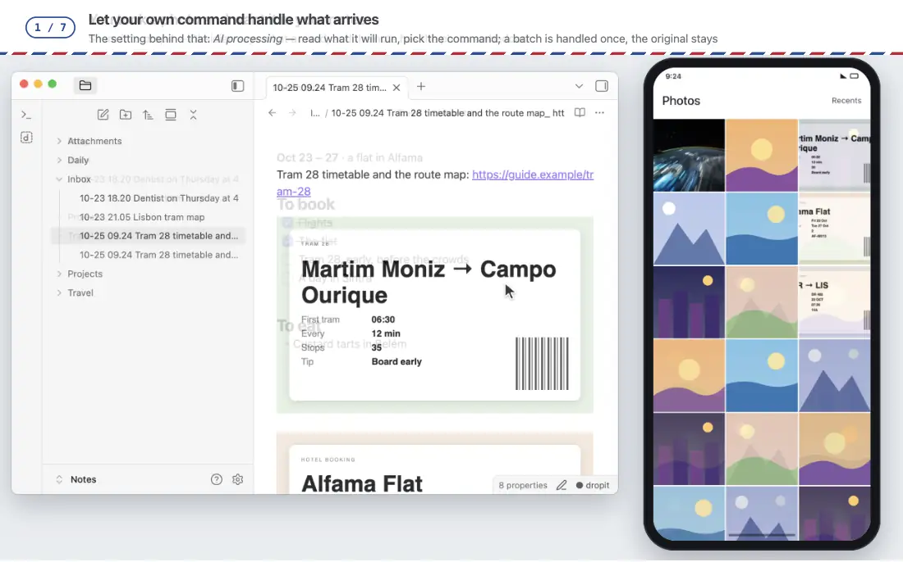

# dropit (sync and send anything to phone and PC)

**English** · [简体中文](./README.zh-CN.md)

**What you send from your phone, your browser or your terminal lands in your vault as notes —
titled, images embedded, sources linked. And anything in your vault goes out with a right-click.**

Desktop and mobile. Part of [dropit](https://github.com/smart-kits/dropit-client), a private pipe between your own devices.



<sub>Shown: Lonely Planet pages · a NASA photograph (public domain).</sub>

## What it's like

| Somewhere else, you… | In your vault, a few seconds later |
|---|---|
| Share a photo from your iPhone | A note named `10-04 15.30 IMG_2041`, the photo embedded, saved where your attachments go |
| Send a web page from Chrome | `[The article's title](link)` with the author's summary as a quote — not a bare URL |
| Select a paragraph in the browser and send it | The paragraph, and under it `— [Page title](link)`, so you always know where it came from |
| Send some text and three screenshots at once | **One** note: the text on top, the three images below |
| Type `dropit send "call the bank"` in a terminal | A note that says *call the bank* |
| Close the laptop for a weekend | Everything sent meanwhile, the moment you open Obsidian again — nothing missing, nothing twice |

And the other way: right-click a note, a PDF or a few images in the file list → *Send to dropit*,
and they're on your phone.

## The other devices, and how they find each other

The plugin is one device of one account; the other devices are other dropit clients, joined to the same account. Pick what fits each device
(the install page [dropit.smart-kits.xyz](https://dropit.smart-kits.xyz) recommends one for whatever you open it on):

| Device | Client | Sends | Receives | Get it |
|---|---|---|---|---|
| **iPhone · iPad** | The **dropit** shortcut (share sheet, Back Tap) | ✓ | — (read it here in Obsidian mobile, or in the web inbox in Safari) | Open the site in Safari → *Install the shortcut* |
| **Android** | The dropit app | ✓ | ✓ (a notification) | The APK on the site or in [Releases](https://github.com/smart-kits/dropit-client/releases) |
| **Chrome · Edge** | The extension | ✓ | — | The site → *Devices*, or [the repository](https://github.com/smart-kits/dropit-client) |
| **Terminal** (macOS, Linux) | `dropit` | ✓ | ✓ | The site → *Devices*, or [the repository](https://github.com/smart-kits/dropit-client) |
| **Any browser** | The web inbox | ✓ | ✓ (press *Pull new items*) | Nothing to install: the site itself |
| **Obsidian on your phone** | This plugin, on the mobile app | ✓ | ✓ | Community plugins, like this one |

**Joining each of them:** *Settings → dropit → Add a device* shows a 6-character code and a QR code, valid 5 minutes. Type it on the other device, or scan
the QR code with its camera (on an iPhone it opens the shortcut's setup with the code filled in). The first device creates the account;
every other one joins with a code like this. When every device slot is in use, the code comes with a line saying which device the new one will replace (the one idle longest; *Replace a different one* picks another), and with no device to replace it shows no code and points to the device list to remove one first.

**A good setup:** send from your phone with the shortcut (iPhone) or the app (Android), from the browser with the extension; receive everything here as notes.
To read what you sent from this computer on your phone, put the plugin on Obsidian mobile too, or open the web inbox.

## Where things land

Pick once in *Settings → dropit → Receiving → Write items as*:

| Choice | What you get |
|---|---|
| **A new note for each** (default) | One note per delivery in a folder you choose (`Inbox`), named by time and what it's about |
| **The end of one note** | Everything appended to a single note (`Inbox/dropit.md`), each under a time line |
| **Today's daily note** | Appended to today's daily note — your folder, date format and template from the *Daily notes* plugin; Templater templates are handed to Templater |

Files — images, videos, PDFs — are saved where Obsidian puts attachments (*Settings → Files and links*)
and embedded with your own link style, wikilinks or Markdown.

### A new note for each

```markdown
---
kind: url
source: chrome-extension
created: 2026-10-04T07:30:00.000Z
dropit_seq: 42
---

[How Airmail Worked](https://example.com/airmail)

> A short history of the red-and-blue envelope.
```

The file name is the time plus what it's about: `10-04 15.30 How Airmail Worked`. A link without a title
becomes `example.com/airmail`; text becomes its first line; a file its own name.
Things sent together share one note — text on top, files embedded below.

### The end of one note, or today's daily note

```markdown
**10-04 15:30** · ios-shortcut
![[IMG_2041.jpeg]]

**10-04 15:42** · chrome-extension
A paragraph worth keeping.

— [Page title](https://example.com/page)
```

Note: the daily note is the one for the day the item is **written**. Items caught up after a few days
offline go into today's note, not the day they were sent.

## Sending from your vault

| Where | What goes out |
|---|---|
| Select text in a note → right-click → *Send to dropit* | The selected text (a lone link is sent as a link) |
| Right-click a file in the file list → *Send to dropit* | A note goes as its Markdown text; any other file as the file itself |
| Select several files → right-click → *Send N files to dropit* | Up to 10 files, arriving together as one delivery |
| Command palette: *dropit: Send current note* · *dropit: Send selection* | The same, from the keyboard — bind them to hotkeys under *Settings → Hotkeys* |

A note goes as its text, front matter included; images embedded in it aren't sent along — select them
in the file list too. What you send from this vault is never written back into it.

## The status bar

One glance tells you the state; click it to sync now.

| Shows | Means |
|---|---|
| `● dropit` | Real-time delivery on (hover for the days left of a trial) |
| `◌ dropit` | Connecting |
| `↻ dropit` | Syncing |
| `○ dropit` | No real-time delivery on your plan right now: syncs when Obsidian opens or you come back to it |
| `○ dropit · offline` | Disconnected — reconnecting by itself |
| `⚠ dropit` | Something failed — hover for why; it tries again by itself (after about 5 s, 15 s, then every minute — later if the server asks for that). If this vault was removed from your account, it stops trying until you pair again or click to sync |
| `dropit · not paired` | Click to set it up |

When items arrive, one notice says how many — click it to open the last one.

## Nothing missed, nothing twice

- **Coming back catches up.** Open Obsidian, or switch back to it, and whatever arrived meanwhile is written.
- **A flaky network is ridden out.** A connection dropped on the way (a proxy, patchy Wi-Fi) is tried again
  before it counts; a failed sync retries on its own.
- **A file that won't download doesn't block the rest.** A line takes its place:
  `⚠️ report.pdf (820 KB) couldn't be downloaded: … Settings → dropit → Pull again tries once more.`
- **Pull again** (*Settings → dropit → Receiving*, last row): one row with two sliders side by side and a button (on a narrow window each slider gets its own line): how many (1–50, starting at 10) and how many days back (1 up to the days Paid keeps items, starting at 1); it pulls the latest N items from the last D days, both limits at once. A free account keeps items 1 day, so its days slider stays at 1 — trying to move it shows a line under the row with what Paid would allow, and a link to the plans. A paid account can slide up to the days its items are kept. What's already in
  the vault is skipped, failed downloads are fetched again. With *A new note for each*, a note you deleted
  comes back; in the other two modes, what you deleted stays deleted. Pulled-back items are only written as notes; they are not handed to the AI.
  Notes carry a short `dropit_account` mark, so a vault paired with another account later doesn't mistake that account's items for its own.
- A newly joined device starts with what's sent after it joined; *Pull again* fetches what came before,
  for as long as your plan keeps items.

## Process what arrives with an AI agent or a command

*Settings → dropit → Receiving → After it arrives → AI processing* hands what arrives to a command line AI agent already
installed on your computer, or to a command of your own. A received text or link becomes **one note: what was sent,
quoted, then the result**.

```text
Inbox/10-16 14.02 Thursday meeting.md          ← the same note, once it was processed
    > Thursday 9:00 meeting with the supplier, bring the budget sheet. Send the quote to Li before Friday.

    ---

    This is a to-do: one meeting and one follow-up.
    - Meeting Thursday 9:00, bring the budget sheet
    - Send the quote to Li before Friday
```

- **It is off until you turn it on, and the first time you are shown what it will do:** the program and its full
  list of arguments, its permission, and that **everything that arrives and matches the rule is handed to the agent
  you chose**. dropit does not handle or keep it, and does not call a model or keep a key — the agent uses its own sign-in.
- **Pick the agent; its command is written out, and yours to edit.** The list holds what is found on this computer out of Claude Code,
  Codex CLI, Grok CLI, Gemini CLI and Pi, and *Custom command* for a program of your own. Whatever you pick, the *Command* line shows what
  dropit will start (no shell involved; what arrived goes in on standard input, never into the command). Edit it to run the agent your
  way; *Reset* brings the default back. For Claude Code the default also gives each item only what it needs (below); an edited command
  runs exactly as written. For an agent dropit has not checked, the default is what its own help suggests.
- **Four boxes in one row.** *Text* (tidy and summarise), *Links* (read the page), *Images & PDFs* (copy the text out), *Audio & video*
  (transcribe). The boxes write the **prompt** (folded under them); edit it freely. Ticking again rewrites it only if you have not
  changed it. Each item is one call, and the agent decides what to do with it.
- **A received text or link turns into its answer.** Its front matter stays, and so does the page it came from. Nothing is lost:
  what arrived is the quote, and if the agent fails the note stays exactly as it arrived. *Keep the original note* leaves the received note
  as it was and writes the result as a note beside it, `<original name> · <rule name>`. A received **file** is always kept, with
  the result in a note beside it. A note that holds several items (an appended note, today's daily note, a batch) is never
  replaced; its items get a note each, with the item's number in the name.
- **By hand:** *dropit: Process this note with…* runs the rule on the open note (it works while the rule is off); the result is
  always a note beside it and the note is never changed. *dropit: Re-run the last handler* runs it again.
- **Try it, and see what runs:** The small *Try it* button beside the AI switch really runs it on the latest item, after asking. The *Show…* button on the command row shows, for an
  example item and without running anything, the exact command, what the agent would be sent, and its environment.
- **A failure is said on screen**, at most once a minute, so a missing agent does not fill the screen. The note it was about stays
  as it arrived. dropit keeps no record of runs.
- **Limits** (folded by default) are your own numbers: a minimum length for text, a time limit, the longest text, the largest file, how many of a backlog get processed (the newest 3 by default; 0 = all; the rest are still written to your vault), and, for Claude, a model name (passed as `--model`; empty uses Claude's own default).
  There is none built in. The text limits are for words: when the words of a batch sent together are longer than the longest and it has files, the words are left out (the agent is told) and the files are still handled; the minimum only applies to a text on its own. A batch of words alone that a limit turns away says so in a notice.

### What the agent gets to use

dropit decides this per item, from what arrived:

| Arrived | Claude Code gets |
|---|---|
| A text | No tools: it reads what it is given and answers in text |
| A link | One website: the one the link points to. A link that redirects elsewhere is not checked |
| An image, a video, a file | A copy of that one file in an empty temporary folder, to read, and nothing else |

Only **Claude Code** has been checked (version 2.1.301), so it is the only one that gets this per-item permission. It cannot
read audio or video; its answer says so when it is handed one. For those, use a command that can. **Codex CLI, Grok CLI, Gemini CLI
and Pi** are found if installed and can be picked, but dropit has not checked what their settings can be held to, so what they
may do is up to you.

### Safety

- **What arrives is untrusted input.** Anyone holding a send-only key for your account can put text in front of the
  agent. So the content only ever goes to the agent's **standard input**, inside a block marked as data, never onto a
  command line and never into your instructions; and for a text, Claude Code **has no tools**.
- **The agent starts in an empty temporary folder** with only `PATH`, `HOME` and `USER` in its environment, a time
  limit, and no retry. The folder is removed afterwards.
- **Its answer is cleaned before it is written**: remote images and embeds, HTML, the language of code blocks (a
  block tagged for a query or script plugin would run), and template and query syntax are all neutralised. The quoted original
  is written as it was received (with Templater's `<%` defused while it runs new notes, as for any received note).
- **A failure never stops an item arriving.** The item is written first; processing comes after.
- In your prompt, `{{kind}}` is the only variable that means anything: others are dropped, because titles, file names
  and text are written by whoever sent them.

**Desktop only.** On a phone this part of the settings says so and nothing is ever started; receiving works as usual.

### No limits on the agent

By default Claude Code gets only what each item needs. If you want an agent that can do more (open pages that need a login, use a key
for a link that is not public, run a skill or an MCP server, work on a video), tick **Don’t limit the agent** next to the four boxes. It asks once,
with the warning in full.

With it on, dropit adds nothing and takes nothing away: it starts `claude -p --no-session-persistence` (the *Command* line shows it).
Claude Code runs with **your own settings** (skills, MCP servers, hooks, instructions, allow and deny rules) and **your whole
environment**. The item's file is copied into the working folder, as before. Untick it to go back.

- **This is the setting that matters most for safety.** What arrives is still untrusted, and anyone holding a send-only key for your
  account can put content in front of the agent. With no limits that content can steer an agent that has everything your own setup
  allows, with nobody there to confirm. Remove devices you no longer use, and keep the permissions in your Claude Code settings as
  tight as the job allows.
- **The permissions are yours.** The run is unattended, so nothing can ask you: an action that needs approval is refused unless your
  Claude Code settings already allow it. To let it do something, allow it there.
- **To limit it,** put allow and deny rules in your Claude Code settings, or edit the *Command* line and name what it may use, for
  example `claude -p --permission-mode dontAsk --allowedTools WebFetch --disallowedTools Bash` (see `claude --help`: `--allowedTools`,
  `--disallowedTools`, `--permission-mode`, `--add-dir`). An edited command is run exactly as written and gets only `PATH`, `HOME`
  and `USER`, so a key it needs belongs in your script or your keychain.
- **Skills, tools, MCP servers:** set them up in Claude Code itself; with no limits they are loaded, and your prompt can ask for them.
  *Show…* lists the command and the names (not the values) of the environment it would get.
- Obsidian started from the Dock or Start menu may not see variables you set in your shell profile. If the agent needs one, put it in
  Claude Code's own settings or in a script that sets it.

**Reading what is said in a video** (Douyin, TikTok, Bilibili…) is written up step by step in [the guide](https://github.com/smart-kits/dropit-client/blob/main/docs/ai-videos.md): the tools, a small script, what to allow, and what was and was not tested.

Some things people set up this way. These are your own setups, not features of dropit, and dropit has not checked them:

- *Video, audio:* a script of your own (a downloader and a speech-to-text tool, say) as a custom command.
- *Pages behind a login:* an MCP server that drives a browser with its own saved profile, called from the prompt.
- *Links that are not public:* a key in your script or keychain that the command sends along.

## Run your own command after each item

*Settings → dropit → Receiving → After it arrives → Run an Obsidian command* picks any Obsidian command — a QuickAdd macro, a
Templater script, another plugin's action. It runs once for each item, **after** the item is in the vault.
(To hand items to an AI agent you don't need this: see *Process what arrives with an AI agent* above. The two work together: this runs first, and if it changes the note, the AI's result is written beside it instead of replacing it.)

- **Delivery never depends on it.** The item is written first; the command runs afterwards, once, with no retry.
- **One item at a time**, a second apart.
- **dropit defines the format; your script is yours.** The plugin does nothing with the content beyond writing it.

Your script reads the current item from `app.plugins.plugins.dropit.received`:

```js
{
  v: 1,                      // format version
  seq: 42,                   // the item's number, increasing
  kind: 'image',             // 'text' · 'url' · 'image' · 'video' · 'file' · …
  source: 'web',             // where it was sent from
  created: '2026-09-29T07:30:00.000Z',
  batch: { id: 'b3k9x0', index: 2, count: 3 },   // null when sent on its own
  text: '',                  // the text or link; '' for files
  meta: { filename: 'budget.png', mime: 'image/png' },   // also title / description for links;
                             // from: { url, title? }, the page it was sent from (browser extension)
  note: 'Inbox/09-29 15.30 Slides for the 3pm meeting.md',   // where it was written
  files: ['Inbox/budget.png'],                   // files saved to the vault for it
}
```

`app.plugins.plugins.dropit.recent` holds the last 20. From another plugin or a startup script you can also
listen directly — every item, no command needed:

```js
app.workspace.on('dropit:received', (item) => { /* same object */ });
```

For example, a QuickAdd macro's user script:

```js
module.exports = async ({ app }) => {
  const item = app.plugins.plugins.dropit.received;
  if (item.kind !== 'url') return;
  // …your own processing
};
```

> **Treat the content as untrusted input.** Anyone holding a send-only token for your account — an
> old phone, a leaked shortcut — can put anything into it. Don't `eval` it, and never build a shell
> command line out of it: pass it to a program on **stdin** or in a file. The object is frozen, so a
> script can't change what the next one sees.

## Account, plan and network

- **A dropit account is required.** Creating one is free, in the plugin (*First time using dropit? → Create a new account*)
  or at [dropit.smart-kits.xyz](https://dropit.smart-kits.xyz). It asks for no name, email or phone number.
  When many accounts were created from your network today, the plugin may show *preparing the account…* for a few
  seconds (it does a small calculation on your computer, nothing is sent for it) and then carries on by itself.
  If that doesn't work, it asks you to create the account in the browser instead.
- **Free to use; an optional paid plan raises the limits.** Everything described here works on the free plan, within its limits:
  20 items a day, files up to 10 MB, items kept for 1 day, 2 devices, and real-time delivery for the first 14 days
  after signing up. After that, new items come in when Obsidian opens, when you come back to its window, or when you
  click *Sync now*. The plugin tells you once when the real-time delivery period is about to end and once when it has ended
  (what you used it for, what changes, and what keeping it costs), and once when a paid year is about to end or has ended; each comes with one link
  to the plans page. While the period is ending or over, a small *Keep real-time* item also shows in the status bar, and the account line in the settings has a *See plans* link
  (for a paid year that is about to end, *Renew*). Nothing else is shown.
- **Payment.** The paid plan costs $19.90 a year (the first month is $1.90), $29.90 for one year paid once, or $49.90 once for lifetime (limited), plus local tax:
  300 items a day, files up to 100 MB, 10 devices, items kept 10 days, real-time delivery always on.
  You pay on the website ([pricing](https://dropit.smart-kits.xyz/#pricing)), never inside the plugin, and the plugin works the same
  either way. Checkout asks for an email, where the receipt goes. Cancel anytime; payment and refund terms are in the
  [terms](https://dropit.smart-kits.xyz/terms).
- **Network use.** The plugin talks to one service, the dropit server, over HTTPS and a WebSocket, to send and
  receive your items. No telemetry, no ads. Details in [Privacy](#privacy).
- **Files.** It reads and writes only inside this vault. It doesn't scan your notes: only when an item comes back a
  second time (*Pull again*, or a sync that was cut short), it looks up the `dropit_seq` (and other `dropit_…`) fields in each
  note's front matter through Obsidian's metadata cache, so the item isn't written twice. It never reads note bodies for this.
- **Clipboard.** *Add a device → Generate a pairing code* writes the code to the clipboard so you can paste it.
  The plugin never reads the clipboard.

## Set up

1. **Install.** *Settings → Community plugins → Browse*, search **dropit**, *Install*. Or download it from
   [dropit.smart-kits.xyz](https://dropit.smart-kits.xyz) and unzip it into `<your vault>/.obsidian/plugins/`,
   or clone it there:

   ```bash
   git clone https://github.com/smart-kits/dropit-obsidian.git "<your vault>/.obsidian/plugins/dropit"
   ```

   Then *Settings → Community plugins* → enable **dropit**.
2. **Join.** *Settings → dropit* opens on *Join with a pairing code*. On a device you already use, show a
   code (web inbox: *Devices*; terminal: `dropit code`), type its 6 characters, press *Join*.
   Your first device ever? *First time using dropit? → Create a new account*.
3. **Add your other devices from here.** *Settings → dropit → Devices → Add a device → Generate a pairing code*:
   type the code on the new device, or scan the QR code with its camera. The code is copied for you,
   and the page notices when the device has joined.

Using an AI coding agent (Claude Code, Codex, Cursor…)? Paste this and it installs the plugin for you:

```text
Install the dropit plugin into my Obsidian vault by following
https://raw.githubusercontent.com/smart-kits/dropit-obsidian/main/AGENTS.md
Ask me which vault and before creating an account, and never show or commit my token.
```

## Settings

| Setting | What it does |
|---|---|
| *(top line)* | The connection state and your account: plan · devices · space · how long items are kept. *Sync now* next to it |
| **Receiving** | *Write items as* · *Folder* · *Note*: where items land (above). Then a part called *After it arrives*, with two separate rows, either or both: *AI processing* (desktop only; with *Try it* beside the switch, and below it a fold called *AI settings*, closed by default and showing which agent is picked: inside it, in one panel, the agent, what to handle (with *Keep the original note* at the end of that row; a custom command says it runs exactly as written, with no limits), the prompt, and the limits and the command, both folded) · *Run an Obsidian command*. *Pull again* is the last row |
| **Devices** | *Add a device* (a pairing code and its QR code). Then one list of the devices on your account, this computer first. Once at least two other devices can receive, above the list: *This computer sends to by default*, with a checkbox on each of those devices. All ticked (the default) sends to all your devices, including ones you add later; tick fewer to send only to those. It is saved the moment you tick, on this computer only (in this plugin's `data.json`), and at least 1 device stays ticked. A device you removed is taken off the next time the page opens, with a notice; if every chosen device is gone the default goes back to all. The commands, the file menu and *Send N files* all follow it. A send-only device has no checkbox, and neither does this computer. At the end of each row: *Remove* on another device (it stops right away), *Sign out* on this computer (it asks first; then this computer leaves the account, the notes already in your vault and your settings stay, and joining again with a pairing code is how you come back). Then a link to the install page |
| **Advanced** | *Server address* (only if you were given another one. With the default, a spare built-in address is tried last; an address you type in yourself is the only one used, and if it is down nothing is sent anywhere else). Before you are paired this is the only other group besides the pairing rows |
| *(bottom)* | *Report a problem* (a new public issue with your versions filled in) · *Source code* |

Each group has its own icon, folds with a click anywhere on its title row, and says how it is set while folded. Explanations live behind the small (i) next to a name: hover it, or click it where there is no hover.

The interface follows Obsidian's language: English, or Simplified Chinese when Obsidian is set to Chinese.

## When something goes wrong

| You see | It means | Do this |
|---|---|---|
| `⚠ dropit` · *Can't reach the server* | The network or a proxy is dropping connections | Usually nothing — it retries. If it stays, check the proxy, or let it connect to dropit directly |
| *Invalid token* · *This device was removed* | This vault was removed from your account | Join again with a new code |
| *Device limit reached* | Your plan's device count is used up | Remove a device you no longer use (*Settings → dropit → Devices*) |
| *Pairing code expired* | Codes last 5 minutes and work once | Generate a new one |
| *Real-time delivery trial ended* | New accounts get real-time delivery for a while; after that it syncs when you open or come back to Obsidian | Nothing to fix — click the status bar to sync any time |
| `⚠️ … couldn't be downloaded` in a note | The file didn't come down this time | *Settings → dropit → Pull again* |

Anything else: the *Report a problem* link at the bottom of *Settings → dropit* (a public issue). For questions about your account you'd rather not post publicly, email [support@dropit.smart-kits.xyz](mailto:support@dropit.smart-kits.xyz).

## Privacy

- The sign-in is stored in this plugin's `data.json` inside your vault. **If you sync or publish your vault,
  exclude `.obsidian/plugins/dropit/data.json`.** *Sign out* clears it.
  A synced vault that takes `data.json` along (Obsidian Sync with community plugin settings, iCloud, Syncthing, Git)
  also makes every copy receive as the same device, so an item can be written once by each copy. Let one copy receive:
  keep `data.json` out of the sync.
- Text from other devices and web pages is never run as code. If Templater is set to run new notes as templates
  (*Trigger Templater on new file creation*), `<%` in what arrives is written with an invisible zero-width space after
  the `<`, so Templater doesn't see a command in it. It looks the same; the payload your command gets keeps the original.
- Auto-processing is off until you turn it on. Once it is on, what arrives and matches a rule goes to the agent you
  chose, on your computer; dropit keeps nothing of it and keeps no record of runs. Its rule lives in this
  plugin's `data.json`, next to the sign-in, and is not shared with the command line tool.
- Each device has its own key and can be removed on its own; removing one frees its slot at once.
- Pairing this vault again (for example after reinstalling the plugin) takes the earlier pairing's place instead of
  using another slot. To recognize it, the plugin sends the key it had, if any, and a SHA-256 hash of a random ID.
  The ID is made the first time this vault joins dropit and kept in Obsidian's local storage for this vault on this device — not in
  `data.json`, and not synced with the vault — so it outlasts a reinstall. Nothing about your computer or phone goes
  into it, only the hash leaves the device, and it is not a credential.
- The plugin talks to one service, the dropit server, to send and receive your items. What it keeps, for how long and
  who can see it: [Privacy](https://dropit.smart-kits.xyz/privacy).

## Development

```bash
ln -s "$(pwd)" "<your vault>/.obsidian/plugins/dropit"   # edit here, reload in Obsidian
node test.cjs                                             # no dependencies
brew install gitleaks && git config core.hooksPath .githooks   # block tokens from being committed
```

Commit messages are in English. Docs come in pairs — please update both `README.md` and `README.zh-CN.md`.

## License

[MIT](./LICENSE)
